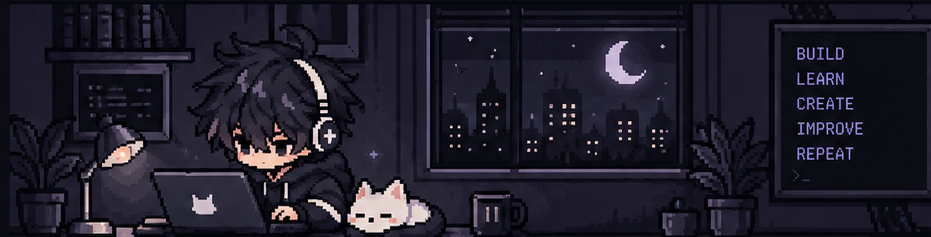
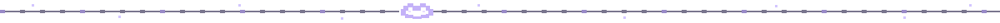

  

  <h1>
    amctl
    
  </h1>
  
developer · programmer · engineer

  
   
  
  
  

## <code>> about.me</code>

- **Currently exploring:** systems, software design, and the tools behind the tools.
- **I value:** open standards, useful software, privacy, and learning by building.
- **Right now:** building projects, improving my setup, and contributing where I can.

## <code>> tech.stack</code>

  
  
  
  
  
  
  

  
  
  
  
  
  
  

  
  
  
  
  
  
  
  
  

  
  
  
  
  
  
  

## <code>> projects/</code>

<table>
  <tr>
    <td width="50%" valign="top">
      <h3><a href="https://github.com/amctl/micrograd-from-scratch">✦ Built Micrograd from Scratch</a></h3>
      
Well micrograd is a library which implement basic classes for a value, neuron, NLP, and implements things like backtracking.

      
<code>Python</code> <code>OPEN SOURCE</code>

    </td>
    <td width="50%" valign="top">
      <h3><a href="https://github.com/amctl/jasmine_sprout_nethunter">✦ Compiled a custom kernel</a></h3>
      
Compiled a custom kernel for jasmine_sprout with nethunter support, also used AnyKernel3 to create a flashable zip file for it.

      
<code>C</code> <code>OPEN SOURCE</code>

    </td>
  </tr>
</table>

## <code>> github.stats</code>

  
  

Stats cards are served by a third-party service and can occasionally hit rate limits. Remove this section if you prefer a profile with no external stats dependency.

  
  
<code>build · learn · create · repeat</code>

  Thanks for stopping by. Have a good one.

